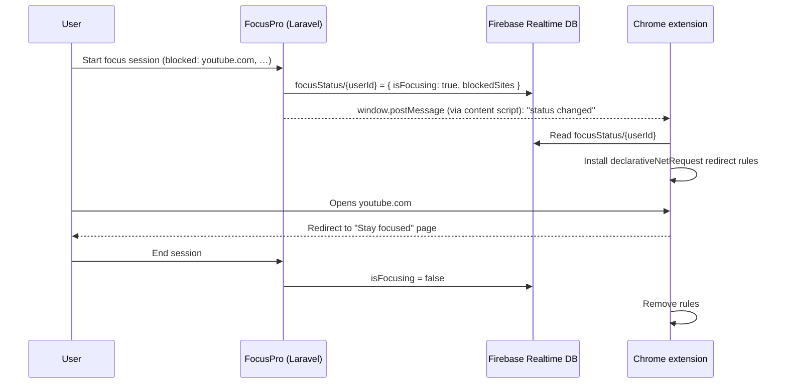

# FocusPro

**Deep work, without the distractions.**

FocusPro is a productivity web app that brings task planning, a Pomodoro focus timer and a distraction blocker into one calm workspace. Plan what matters, protect the time to do it with a focus session that blocks the sites you choose, then look back at your progress with analytics and PDF reports.

Built as my Final Year Project and later extended and redesigned for my portfolio.

<p>
  
  
  
  
  
  
</p>

---

## Features

### Tasks
- Create, edit and delete tasks with a **category**, **due date**, **priority** (P1 Urgent → P4 Low) and **status** (to do, in progress, done).
- Tick a task off straight from the list or the dashboard, with an **Undo** in the confirmation toast.
- Search, filter by category, and sort by due date or priority.
- Overdue and upcoming work is flagged automatically ("Overdue", "Due today", "Due tomorrow").
- Export all tasks, or only completed ones, as a **PDF**.

### Focus sessions (Pomodoro)
- Adjustable focus and break lengths, with a progress ring, Focus/Break modes and the time remaining shown in the browser tab.
- Start a session **on a specific task** from the dashboard's "Up next" list.
- Each finished session (cycles and minutes) is saved to your history.
- The sites you want blocked are remembered between sessions.

### Distraction blocking (browser extension)
- A companion **Chrome extension** blocks the sites you list, **only while a focus session is running**.
- Starting or ending a session on the website switches blocking on or off within a second.
- Blocked sites show a calm "Stay focused" page with a breathing guide, the session's blocked list, a count of distractions blocked today and a link back to your session.
- Tabs that were already open on a blocked site are redirected as soon as the session starts.

### Analytics
- Totals for sessions, cycles, focus hours and average session length.
- Sessions per day for the last 7 or 30 days, focus-vs-break split and task completion rate.
- Downloadable **PDF analytics report**.

### Admin panel
- Platform-wide stats (users, tasks, completion rate, sessions).
- User management: view all users, change roles, delete non-admin accounts.

### Experience
- Minimal, consistent UI built on a small design system (Plus Jakarta Sans, one teal accent, reusable Tailwind component classes).
- Subtle motion with [Motion](https://motion.dev) (the framework-agnostic version of Framer Motion): content rises in on scroll, numbers count up, progress rings draw in. Fully disabled for users who prefer reduced motion.
- Keyboard shortcuts on the dashboard: <kbd>N</kbd> new task, <kbd>F</kbd> start focusing.
- Responsive from phone to desktop, with accessible labels, focus states and live regions.

---

## How distraction blocking works



- **The web app is the source of truth.** The Pomodoro page writes the session state to Firebase under the logged-in user's ID.
- **The extension links itself to the logged-in user automatically.** A content script on the FocusPro site forwards the user ID and "status changed" events to the extension, so there is nothing to configure.
- **Blocking survives Chrome's MV3 service-worker sleeps.** It uses Chrome's `declarativeNetRequest` rules, which keep working while the background worker is asleep. The extension also re-checks Firebase every 30 seconds as a fallback.

---

## Tech stack

| Layer | Technology |
|---|---|
| Backend | Laravel 12 (PHP 8.2+), Laravel Breeze authentication |
| Database | MySQL 8 / MariaDB (app data), Firebase Realtime Database (live focus status) |
| Frontend | Blade, Tailwind CSS 3, Alpine.js, Motion, Chart.js, Vite |
| Reports | barryvdh/laravel-dompdf |
| Extension | Chrome Manifest V3: declarativeNetRequest, webNavigation, alarms, storage |
| Testing | Pest (feature tests on in-memory SQLite) |

---

## Getting started

### Requirements
- PHP 8.2+ with the `pdo_mysql`, `mbstring`, `openssl`, `fileinfo`, `gd`, `zip` and `intl` extensions
- Composer 2
- Node.js 18+ and npm
- MySQL 8 or MariaDB. [WampServer](https://www.wampserver.com/) / XAMPP / Laragon all work.

### Installation

```bash
git clone https://github.com/andiaqil03/FocusPro.git
cd FocusPro

composer install
npm install

cp .env.example .env
php artisan key:generate
```

Edit `.env` to point at MySQL:

```env
APP_NAME=FocusPro
APP_URL=http://127.0.0.1:8000

DB_CONNECTION=mysql
DB_HOST=127.0.0.1
DB_PORT=3306
DB_DATABASE=focuspro
DB_USERNAME=root
DB_PASSWORD=

# Optional: credentials for the seeded admin account
ADMIN_EMAIL=admin@example.com
ADMIN_PASSWORD=password
```

Create an empty `focuspro` database (for example in phpMyAdmin), then:

```bash
php artisan migrate --seed   # tables + demo accounts
php artisan storage:link     # profile photos
npm run build                # or `npm run dev` while working on the UI
php artisan serve
```

Open **http://127.0.0.1:8000**.

### Demo accounts

| Role | Email | Password |
|---|---|---|
| User | `test@example.com` | `password` |
| Admin | `admin@example.com` | `password` (or `ADMIN_EMAIL` / `ADMIN_PASSWORD`) |

To fill an account with **three months of realistic history** (tasks across categories and priorities, about 130 focus sessions) so the dashboard and analytics have something to show:

```bash
DEMO_USER_EMAIL=test@example.com php artisan db:seed --class=DemoActivitySeeder
```

The seeder is deterministic and safe to re-run. It only replaces the data it created.

### Installing the browser extension

1. Open `chrome://extensions` and turn on **Developer mode**.
2. Click **Load unpacked** and choose the `focus_blocker_firebase_fixed/` folder.
3. Open the FocusPro **Focus** page while logged in. The extension popup should show your user ID.
4. Add a site (e.g. `youtube.com`), press **Start**, and try opening it.

The extension recognises the app at `http://127.0.0.1:8000` and `http://localhost:8000`. For a deployed site, add its URL to `content_scripts.matches` in `manifest.json`.

---

## Testing

```bash
php artisan test
```

Feature tests cover authentication, profiles and task security: ownership checks, mass-assignment protection, upload validation and route protection. They run on an in-memory SQLite database, so they never touch your MySQL data.

For a click-through checklist of every feature, see [`docs/MANUAL_TESTING.md`](docs/MANUAL_TESTING.md).

---

## Project structure

```
app/Http/Controllers/        Tasks, Pomodoro, Analytics, Dashboard, Profile, Admin
database/migrations/         Users, tasks, pomodoro_sessions, roles
database/seeders/            Demo accounts + DemoActivitySeeder
resources/views/             Blade pages, layouts and components (x-icon, x-stat-card, chips…)
resources/css/app.css        Design tokens and component classes (.btn, .card, .input, .chip…)
resources/js/motion.js       Reveal / stagger / count-up animations and toasts
resources/js/shortcuts.js    Single-key keyboard shortcuts
focus_blocker_firebase_fixed/  Chrome extension (background worker, blocked page, popup)
docs/                        Manual testing guide
tests/Feature/               Pest feature tests
```

---

## Roadmap

- Secure the Firebase Realtime Database with per-user authentication tokens issued by Laravel.
- Move the Firebase configuration into environment variables.
- Dark mode.
- Weekly focus goals and streaks.
- Publish the extension to the Chrome Web Store and support Firefox.

---

## Author

Built by **[@andiaqil03](https://github.com/andiaqil03)**.
